# Geoclick — Handbuch

Geoclick ist ein Geografiespiel von Diego Amicabile. Dieses Handbuch beschreibt **Geoclick v1.1.0**, den Kandidaten für die Veröffentlichung der Version 1.1.0. Die tatsächlich laufende Version und ihre Build-Kennung stehen im kleinen Versionsfeld und auf der Informationsseite.

Die gemeinsam mit dem englischen Handbuch verwendeten Bilder zeigen englische Beschriftungen und beispielhafte Lernstände. Die Schaltflächennamen in diesem Text entsprechen der deutschen Oberfläche. Die Abbildungen der Windows- und Android-App stammen aus früheren Versionen; die beschriebenen Funktionen entsprechen dem aktuellen Spiel.

## Inhalt

1. [Was ist Geoclick?](#1-was-ist-geoclick)
2. [Geoclick bekommen](#2-geoclick-bekommen)
3. [Die Ansichten im Zusammenhang](#3-die-ansichten-im-zusammenhang)
4. [Die Startseite](#4-die-startseite)
5. [Bedienelemente auf der Karte](#5-bedienelemente-auf-der-karte)
6. [Gewusst](#6-gewusst)
7. [Übersicht](#7-übersicht)
8. [Quiz](#8-quiz)
9. [Wann ein Ort als gewusst zählt](#9-wann-ein-ort-als-gewusst-zählt)
10. [Tour](#10-tour)
11. [Städtekarten](#11-städtekarten)
12. [Wissenswertes und Ortsnamen](#12-wissenswertes-und-ortsnamen)
13. [Gelände](#13-gelände)
14. [Meine Karten](#14-meine-karten)
15. [Das Tutorial](#15-das-tutorial)
16. [Sprachen](#16-sprachen)
17. [Auf dem Telefon](#17-auf-dem-telefon)
18. [Windows und Android](#18-windows-und-android)
19. [Daten und Privatsphäre](#19-daten-und-privatsphäre)
20. [Der Kartenkatalog](#20-der-kartenkatalog)
21. [Häufige Fragen](#21-häufige-fragen)
22. [Begriffe](#22-begriffe)

## 1. Was ist Geoclick?

Du lernst, wo Länder, Hauptstädte, Regionen und Städte liegen, indem du ihre Namen auf der Karte platzierst. Der Katalog umfasst **221 Karten in 81 Ländern und auf den sechs Kontinenten**. Jede Karte bietet Gewusst, Übersicht, Quiz und Tour. Das Spiel merkt sich deinen Lernstand auf dem Gerät: Jede richtige Antwort beim ersten Versuch hebt einen Namen eine Stufe, jeder Fehler senkt ihn eine Stufe. Ein Konto brauchst du nicht. Oberfläche und geschriebene Ortsinformationen gibt es auf Englisch, Deutsch und Italienisch.

Du kannst im Browser oder mit der Windows- beziehungsweise Android-App spielen. Ein Tutorial führt durch die wichtigsten Handgriffe und kann später wiederholt werden, ohne den wirklichen Lernstand zu verändern.

## 2. Geoclick bekommen

Die offiziellen Downloads stehen auf der [Versionsseite von Geoclick2027](https://github.com/diegoami/Geoclick2027/releases). Die itch.io-Seite ist [diegoami.itch.io/geoclick](https://diegoami.itch.io/geoclick). Welche Dateien dort angeboten werden, hängt von der veröffentlichten Version ab.

Unter Windows startest du das Installationsprogramm. Unter Android installierst du die APK-Datei; das System kann dafür eine Freigabe für die verwendete Installationsquelle verlangen. Die Apps bringen die Karten mit und können ohne Internetverbindung gespielt werden. Im Browser werden die benötigten Dateien vom Anbieter der Webseite geladen. Ein Update über die bestehende App bewahrt ihre Daten, wenn App-Identität und Signatur gleich bleiben.

## 3. Die Ansichten im Zusammenhang

Auf der Startseite wählst du Kontinent, Land und Kartentyp. Eine Karte öffnet sich in **Gewusst**. Die obere Leiste wechselt zu **Übersicht**, **Quiz** oder **Tour**. **Karten** führt zurück zum Katalog. Der Wechsel zwischen Ansichten setzt deinen Lernstand nicht zurück.

Der Stern merkt eine Karte als Favorit vor. **Meine Karten** enthält Favoriten und zuletzt verwendete Karten. Die Informationsseite nennt Autor und Version und verlinkt dieses Handbuch. Der Zurück-Pfeil des Handbuchs und Esc führen zur Startseite.

## 4. Die Startseite

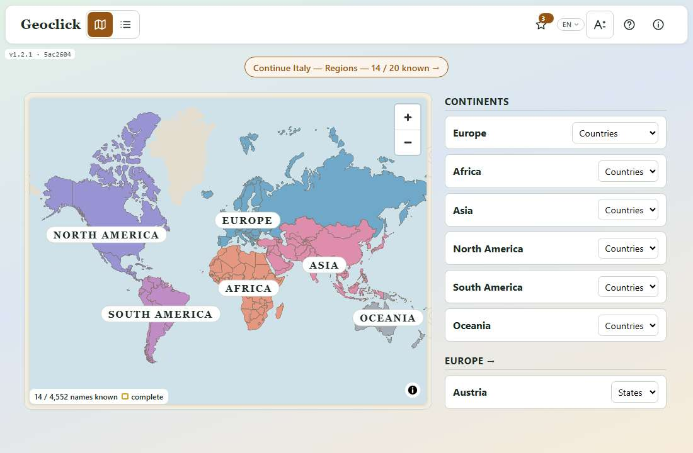

Du kannst zwischen Weltkarte und Liste wählen. Auf der Weltkarte öffnest du zuerst einen Kontinent, dann ein Land. Länder mit eigenen Karten zeigen ihre verfügbaren Kartentypen in der Liste; andernfalls kannst du die Karten des Kontinents öffnen. Die Suche filtert Länder und Kontinente anhand der Namen in der gewählten Sprache.

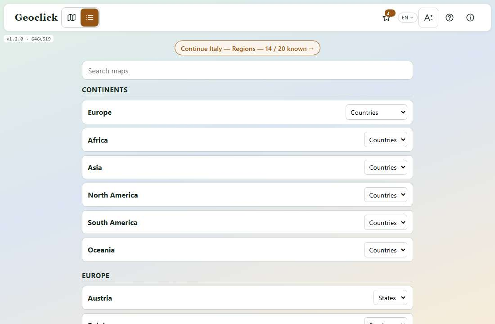

Drücke auf den gewünschten Kartentyp, um ihn zu öffnen. Die Prozentzahl oder Anzahl bei einer Karte zeigt, wie viele ihrer Orte du kennst. Sie ist keine Bewertung der letzten Runde. Die Darstellung und deine Einstellungen werden gespeichert. Das Angebot für das Tutorial erscheint einmal; der Tutorial-Knopf bleibt auch danach erreichbar.

Auf der Weltkarte ist ein Land, das du gespielt hast, von blassem bis kräftigem Grün gefärbt, je nachdem, wie viel du davon weißt. Es zählen seine Regionen- und Städtekarten, keine Detailkarten. Ein Land, das du ganz kennst, bekommt einen **goldenen Rand**; nie gespielte Länder behalten die Farbe ihres Kontinents. Eine kleine Legende zeigt die Farbstufen und deine Summe über alle Karten, etwa „1 240 / 9 800 Namen gewusst“.

Eine Zeile über Karte oder Liste schlägt vor, was du als Nächstes spielen kannst, zum Beispiel „Weiter mit Italy — Regionen — 14 / 20 gewusst“, „Italy — Regionen nochmal spielen — letztes Mal 3 eine Stufe verloren“ oder „Als Nächstes: Italy — Städte — Italy — Regionen kannst du ganz“. Ein Druck darauf öffnet das Quiz dieser Karte. Gibt es nichts vorzuschlagen, oder läuft das Tutorial, fehlt die Zeile.

## 5. Bedienelemente auf der Karte

| Schaltfläche | Wirkung |
|---|---|
| **Karten** | Zurück zur Startseite |
| **Gewusst** | Gelernte und selbst gewählte Namen |
| **Übersicht** | Die Namen zum Nachschlagen |
| **Quiz** | Eine Runde beginnen oder fortsetzen |
| **Tour** | Orte automatisch kennenlernen |
| **Gelände** | Zusätzliche geografische Details ein- oder ausblenden |
| **Ton** | Nur im Quiz: Antworttöne ein- oder ausschalten (anfangs aus) |
| **Tutorial** | Die Einführung starten, fortsetzen oder wiederholen |

Die Zeile darunter wechselt zwischen den Karten desselben Landes oder Kontinents. Der Stern gilt für die gerade geöffnete Karte. **Detaillierte Karten anzeigen** ergänzt feinere Unterteilungen. Eine bereits geöffnete Detailkarte bleibt mit einem **roten X** erreichbar, wenn das Häkchen wieder ausgeschaltet ist. Das X entfernt diesen zusätzlichen Knopf aus der Zeile, ohne den Lernstand der Karte zu löschen.

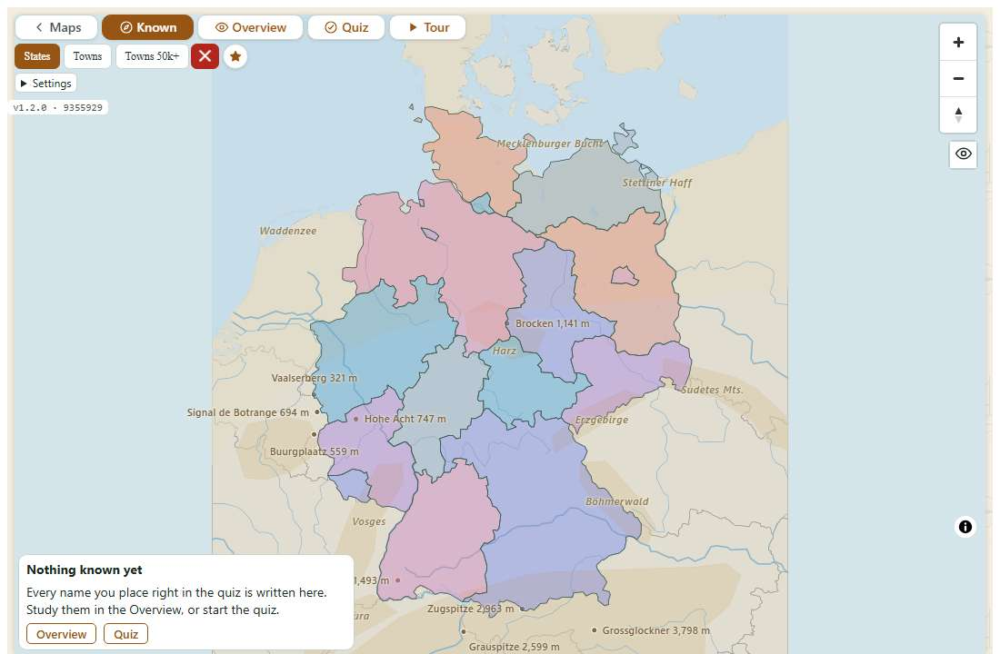

Rechts ändern **+** und **−** den Zoom. Der Kompass richtet die Karte wieder nach Norden aus. Zoomen geht auch mit Mausrad oder zwei Fingern; Ziehen verschiebt die Karte. Ein weiterer Knopf unter den Navigationsknöpfen blendet die Leisten aus oder wieder ein. Das Sprachmenü wechselt die Sprache. Über den Informationsknopf der Karte bleiben Quellenangaben und Lizenzen zugänglich.

## 6. Gewusst

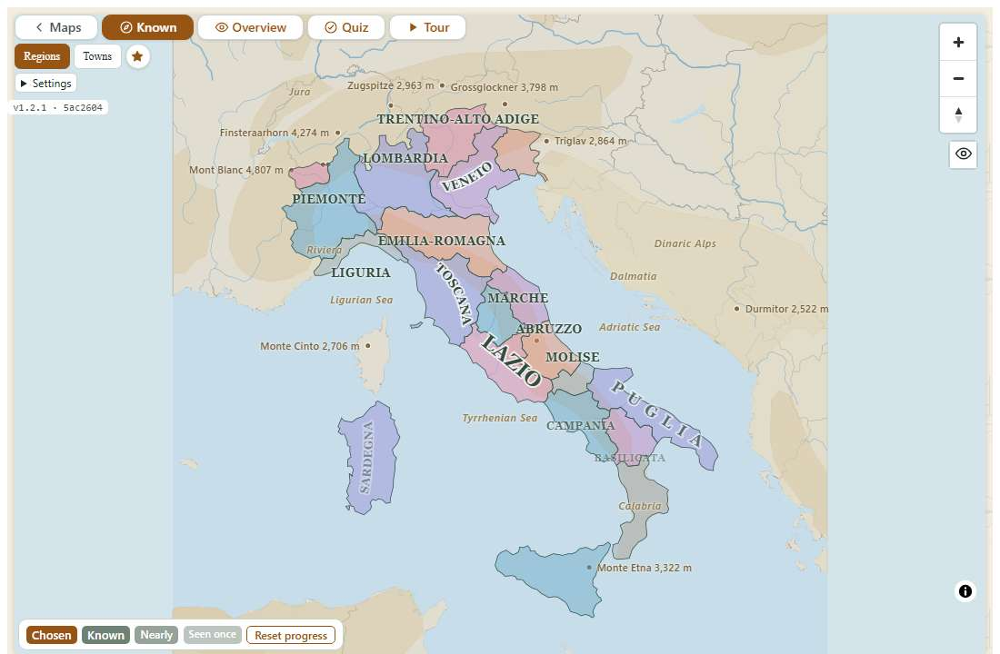

Hier entsteht deine persönliche Karte. Die Stärke eines Namens folgt seiner Stufe (siehe Abschnitt 9): **Gewusst** ist die oberste Stufe, **Fast** eine darunter, **Einmal** zwei darunter. Ein Name ohne Stufe wird nicht automatisch angezeigt.

Klicke oder tippe auf einen Ort, um seinen Namen hinzuzufügen; noch einmal nimmt ihn wieder weg. Du kannst mehrere Namen gleichzeitig wählen. **Gewählt** unterscheidet solche Namen von denen, die du im Quiz verdient hast. **Zurücksetzen** entfernt die vorübergehenden Auswahlen und zeigt wieder den erworbenen Lernstand. Es löscht keine erreichten Stufen. Die Auswahlen gelten für die laufende Sitzung.

Wenn Informationen verfügbar sind, öffnet die Auswahl auch eine Ortskarte mit Wissenswertem. Auf einer Städtekarte tippst du auf den Punkt. Das erneute Ausblenden des Namens schließt die Ortskarte. In dieser Ansicht gibt es keine Bewertung.

Auf einer nie gespielten Karte erscheint eine kleine Karte **Noch nichts gewusst** mit den Knöpfen **Übersicht** und **Quiz**.

Sobald du auf der Karte etwas erreicht hast, steht in der Legende auch **Fortschritt zurücksetzen**. Ein Dialog fragt nach: „Deinen Fortschritt auf Italy — Regionen zurücksetzen?“. **Abbrechen** ändert nichts; **Ja, zurücksetzen** macht alle Namen dieser Karte wieder unbekannt und löscht auch die gewählten Namen und eine halb gespielte Runde. Deine anderen Karten, deine Favoriten und dein letztes Ergebnis bleiben. Das ist etwas anderes als **Zurücksetzen** in der Legende, das nur die gewählten Namen entfernt.

## 7. Übersicht

Die Übersicht dient zum Lernen und Nachschlagen. Regionen haben dieselbe grüne Farbe. Namen werden so angeordnet, dass sie sich nicht überdecken: Manche stehen versetzt, andere folgen der Form ihrer Region. Was beim ersten Zoom keinen Platz findet, erscheint beim Hineinzoomen. Ein zunächst unsichtbarer Name fehlt deshalb nicht in den Daten.

Mit der Maus kannst du auf einen Namen zeigen, um ihn zu vergrößern. Auf einem Touchscreen tippst du ihn an; ein zweiter Tipp oder ein Tipp daneben verkleinert ihn wieder. Die Auswahl eines Ortes öffnet gegebenenfalls seine Informationen. Hier wird nichts gewertet; eine laufende Quizrunde bleibt beim Wechsel zur Übersicht erhalten.

## 8. Quiz

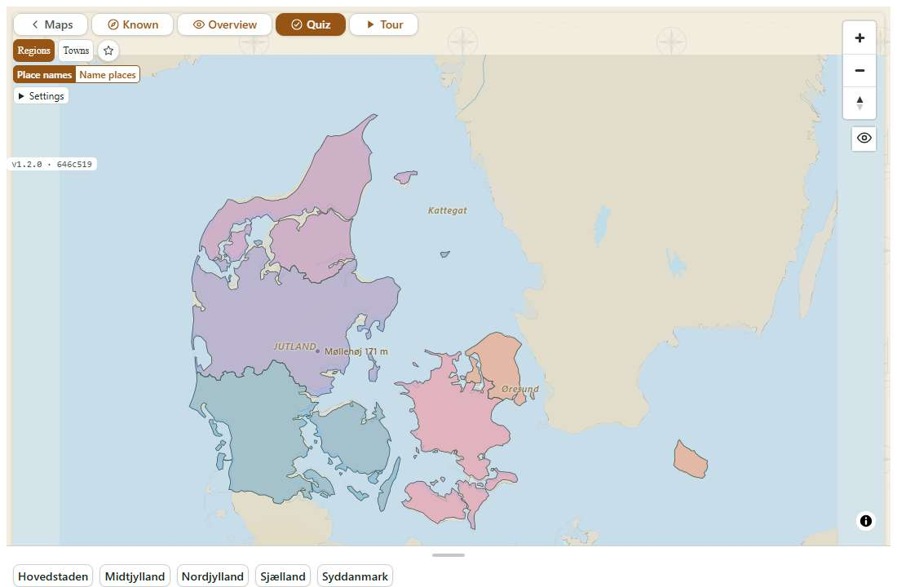

Drücke auf einen Namen in der Ablage, ziehe ihn auf seine Region oder den Stadtpunkt und lass los. Der Name folgt dem Zeiger. Die blaue Hervorhebung zeigt nur, über welchem Gebiet du bist, nicht ob die Antwort stimmt. Auf einem Touchscreen schwebt der Name über deinem Finger, mit einer kleinen orange umrandeten Nadel darunter; die Nadel ist der Punkt, der zählt, damit dein Finger den Ort nicht verdeckt. Am oberen Bildschirmrand steht die Nadel unter dem Finger. Mit der Maus zählt die Zeigerspitze.

Statt zu ziehen kannst du einen Namen in der Ablage antippen oder anklicken: Er hebt sich ab, wird umrandet, und „Tippe jetzt auf seinen Ort auf der Karte“ erscheint. Tippe dann auf seinen Ort. Ein zweiter Tipp auf den Namen, ein Tipp auf die leere Ablage oder Esc lässt ihn wieder los. Es gelten dieselben Regeln wie beim Ziehen. Die Karte zu verschieben zählt nicht als Antwort.

- Richtig platziert bleibt der Name auf der Karte und verschwindet aus der Ablage.
- Ein falscher Abwurf beendet den Zug dieses Namens; in derselben Runde gibt es keinen zweiten Versuch. Der getroffene Ort blinkt rot, und der Name wird an der richtigen Stelle gezeigt, goldbraun statt grün. Die Ortsinformation bleibt bis zum nächsten Abwurf stehen.
- Ein Abwurf aufs Meer, außerhalb der Karte oder zurück in die Ablage zählt nicht als Antwort. Der Name bleibt verfügbar.
- Kleine Ziele lassen sich durch Hineinzoomen leichter treffen. Ein kleiner Toleranzbereich erleichtert den richtigen Treffer.
- Verwechslungen merkt sich das Spiel: Ein Name, den du auf einen anderen Ort gelegt hast, kommt in späteren Runden zusammen mit dessen Namen in die Ablage, damit du beide unterscheiden lernst. Das Paar wird vergessen, sobald du beide Namen weißt.

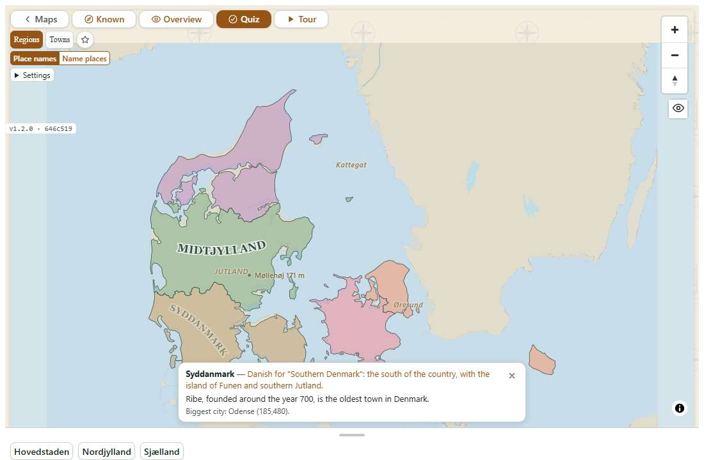

Eine Runde fragt alle Namen der Karte ab. Je mehr du bereits weißt, desto weniger Namen werden gleichzeitig angeboten:

| Gewusster Anteil der Karte | Höchstens gleichzeitig angebotene Namen |
|---|---|
| Unter 25% | 10 |
| Ab 25% | 6 |
| Ab 60% | 3 |
| Ab 85% | 1 |

Die Ablage füllt sich während der Runde nach. Ziehe den grauen Griff nach oben oder unten, um ihre Höhe anzupassen. Mit der Tastatur erreichst du ihn über Tab und verwendest die Pfeiltasten. Wenn nicht alles hineinpasst, kannst du die Ablage scrollen. Beim Öffnen wird die Karte zunächst in den Platz oberhalb der Ablage eingepasst.

Am Ende erscheint **Fertig!** mit den beim ersten Versuch richtigen Antworten, dem Wert der vorigen Runde („Letztes Mal: 14 von 20.“), der gesamten Fehlerzahl, gegebenenfalls gezeigten Namen und dem erreichten Lernstand, bei Bedarf mit „Eine Stufe verloren: 2“. Nur ein sofort richtiger erster Abwurf zählt zur ersten Zahl. Darunter stehen die Listen **Neu gewusst**, **Zum Üben** und **Verwechselt** („Molise auf Abruzzo gelegt“); ein Druck auf einen Namen öffnet seine Ortskarte, lange Listen enden mit „+4 weitere“. **Diese lernen** öffnet Gewusst mit den Namen zum Üben als **Gewählt**. Das X schließt die Ergebnisanzeige; **Nochmal spielen** beginnt eine neue Runde.

Eine Runde behandelt normalerweise die gesamte Karte. Kennst du einige Namen, aber nicht alle, bietet **Die 6 noch nicht gewussten üben** eine Übungsrunde an: neben der Fortschrittszeile (nur vor der ersten Antwort einer Runde), in der Ergebnisanzeige und neben **Nochmal spielen**. Darin stehen die gewussten Namen schon auf der Karte, gefragt werden nur die übrigen; die Fortschrittszeile beginnt mit „Übung ·“. Gewertet wird wie sonst.

Weißt du alle Namen einer Karte, wird jede Runde gestoppt. Es zählt nur die Zeit im Quiz, und beim Spielen ist keine Uhr zu sehen. Die Ergebnisanzeige zeigt etwa „Zeit: 1:42“ und **Neue Bestzeit!**, wenn eine fehlerfreie Runde deine Bestzeit schlägt. Nach einer Runde mit Fehlern steht dort „Nur eine Runde ohne Fehler zählt als Bestzeit.“

**Namen platzieren** und **Orte benennen**, zwei verbundene Knöpfe in der Fortschrittszeile, wählen, wie das Quiz fragt. Bei **Orte benennen** leuchtet ein Ort blau auf, und die Ablage bietet seinen Namen unter vier Namen an; die anderen sind seine nächsten Nachbarn. Ab 60 % gewusst sind es fünf, ab 85 % sechs Namen. Wähle durch Tippen, Klicken oder mit den Zifferntasten 1 bis 6; jeder Name zeigt seine Ziffer. Die Fortschrittszeile lautet „Welcher Ort leuchtet? — 0 / 20 benannt“. Eine falsche Wahl wirkt wie im Ziehquiz: Der gewählte Ort blinkt rot, der richtige Name wird gezeigt, die Ortskarte öffnet sich. Beide Arten zählen für dieselben Stufen. Ein Wechsel beginnt eine neue Runde; die Wahl wird gespeichert. Das Tutorial verwendet immer **Namen platzieren**.

Zum Platzieren brauchst du Maus, Touchpad, Finger oder Stift; einen Namen in der Ablage kannst du auch mit Tab und Enter aufnehmen. **Orte benennen** lässt sich ganz mit der Tastatur spielen.

Du kannst in die Übersicht schauen und zum Quiz zurückkehren, ohne die laufende Runde zu verlieren. Bereits beantwortete Orte ändern ihren Lernstand sofort. Wenn du die Karte ganz verlässt, wird für noch nicht bearbeitete Namen kein abgeschlossener Rundenausgang erfunden.

## 9. Wann ein Ort als gewusst zählt

Jeder Ort hat eine **Stufe**: keine, Einmal, Fast oder Gewusst. Jede richtige Antwort beim ersten Versuch hebt sie um eine Stufe; ein Fehler oder eine gezeigte Lösung senkt sie um eine Stufe, von Gewusst über Fast und Einmal bis zu keiner. Gewusst ist ein Ort nach drei Stufen nach oben, grob gesagt also, wenn du ihn dreimal öfter richtig als falsch platziert hast. Ein Ort kommt in jeder Runde einmal vor; die Stufen entstehen also über mehrere Runden. Die Zeit allein senkt keine Stufe.

Nachschlagen, Informationen lesen und Namen in Gewusst auswählen machen einen Ort nicht von selbst gewusst. Deine Gesamtzahl kann sinken, wenn du einen bereits gelernten Ort falsch platzierst; eine richtige Antwort in einer späteren Runde macht ihn wieder gewusst. Lernstände früherer Versionen gelten weiter. Die Anzeige folgt deinem im Spiel gezeigten Wissen.

## 10. Tour

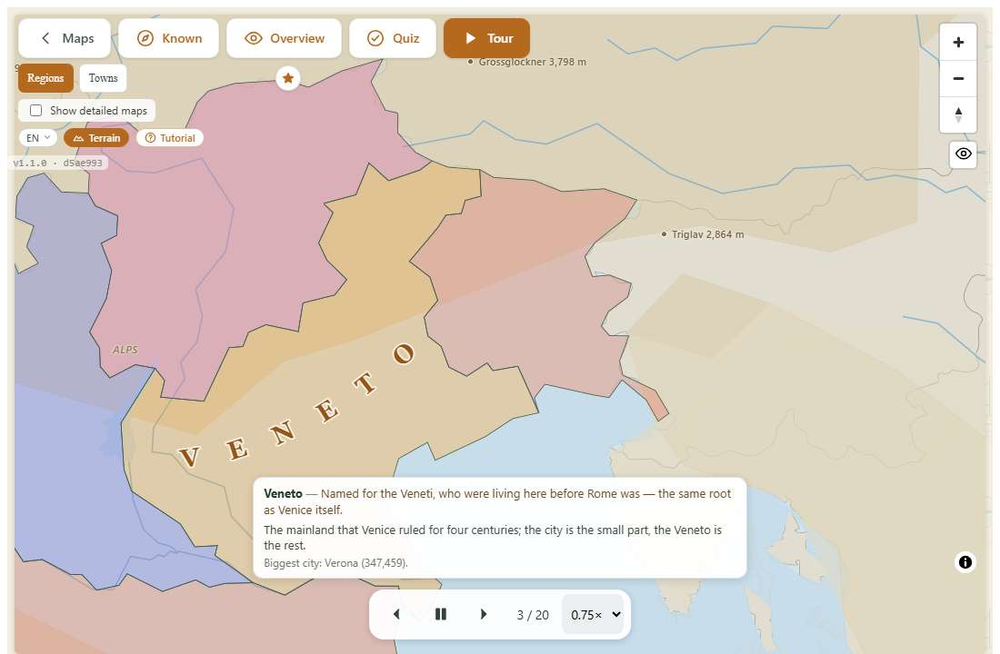

Die Tour startet von selbst und besucht die Orte ungefähr von Norden nach Süden. Sie hebt jeden Ort hervor und zeigt Namen und verfügbare Informationen. Sie ändert keine Punktzahlen oder Stufen.

Die Pfeile springen zum vorherigen oder nächsten Ort. Wiedergabe und Pause starten oder stoppen den Ablauf. Am Ende beginnt der kreisförmige Pfeil wieder von vorn. Ein Zähler wie „3 / 20“ bezeichnet den aktuellen Halt. Am Ende erscheint neben dem Wiederholen-Knopf **Zum Quiz**, das das Quiz der Karte öffnet. Das Tempo bietet 0,5×, 0,75×, 1×, 1,5×, 2× und 3×. Normalerweise beginnt eine Tour mit 0,75×; auf sehr großen Karten wird das Starttempo so angepasst, dass sie nicht unnötig lange dauert. Du kannst weiterhin selbst zoomen und die Karte verschieben.

## 11. Städtekarten

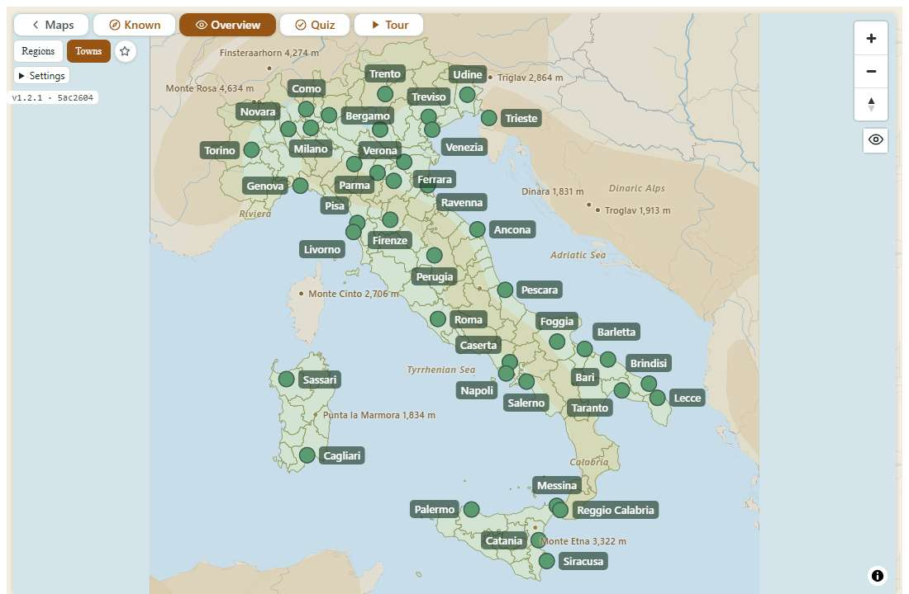

Städte sind farbige Punkte. Verwaltungsgebiete liegen als Orientierung im Hintergrund. Im Quiz ziehst du den Namen auf den Punkt. Innerhalb des Toleranzbereichs zählt der Punkt, der dem Abwurf am nächsten liegt; benachbarte Städte sind nicht austauschbar. Die Beschriftung steht neben dem Punkt, damit das Ziel sichtbar bleibt.

Auswahl und Bevölkerungsgrenze hängen von Land und Datenquelle ab. Es gibt keine einheitliche Schwelle für sämtliche Karten. Große Länder können mehrere regionale Ausschnitte haben. Die USA besitzen eine Karte der größten Städte und drei weitere Ausschnitte für Osten, Mitte und Westen. Derselbe Ort auf zwei verschiedenen Karten hat dort jeweils einen eigenen Lernstand.

## 12. Wissenswertes und Ortsnamen

Die Ortskarte kann Herkunft oder historische Formen des Namens, eine wechselnde weitere Information sowie einen kurzen aus Daten abgeleiteten Hinweis anzeigen, etwa die Region einer Stadt oder die größte Stadt einer Region. Wo ein Herkunftssatz vorhanden ist, bleibt er an erster Stelle stehen; die weiteren Informationen wechseln zwischen Besuchen.

Die geschriebenen Texte sind in alle drei Sprachen übersetzt. Auf detaillierten Karten können ausschließlich abgeleitete Angaben vorhanden sein: Noch nicht jeder Ort hat drei geschriebene Sätze. Für eine richtige Quizantwort musst du die Informationen nicht gelesen haben. Ein X schließt eine schließbare Ortskarte; in der Tour folgt die Karte dem aktuellen Halt.

## 13. Gelände

**Gelände** ergänzt unter anderem Flüsse, Gebirge und geografische Namen hinter den eigentlichen Lerngebieten. Auch ohne diese Details bleiben Land und Meer unterscheidbar. Die Einstellung wird gespeichert und gilt unabhängig von der gewählten Spielansicht. Schalte Gelände aus, wenn Details beim Lernen stören, oder nutze sie als geografische Orientierung.

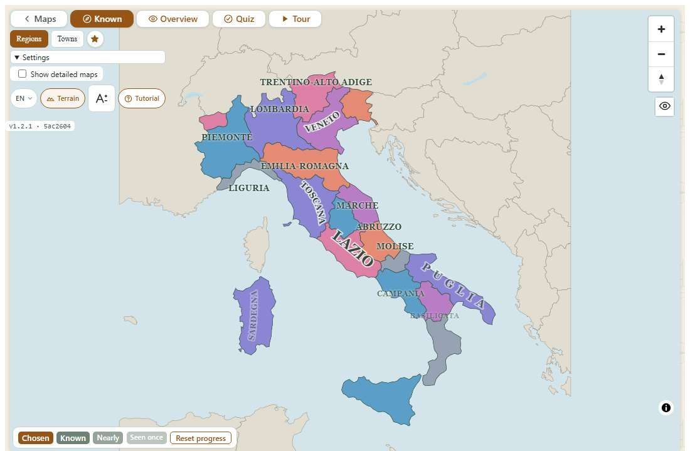

## 14. Meine Karten

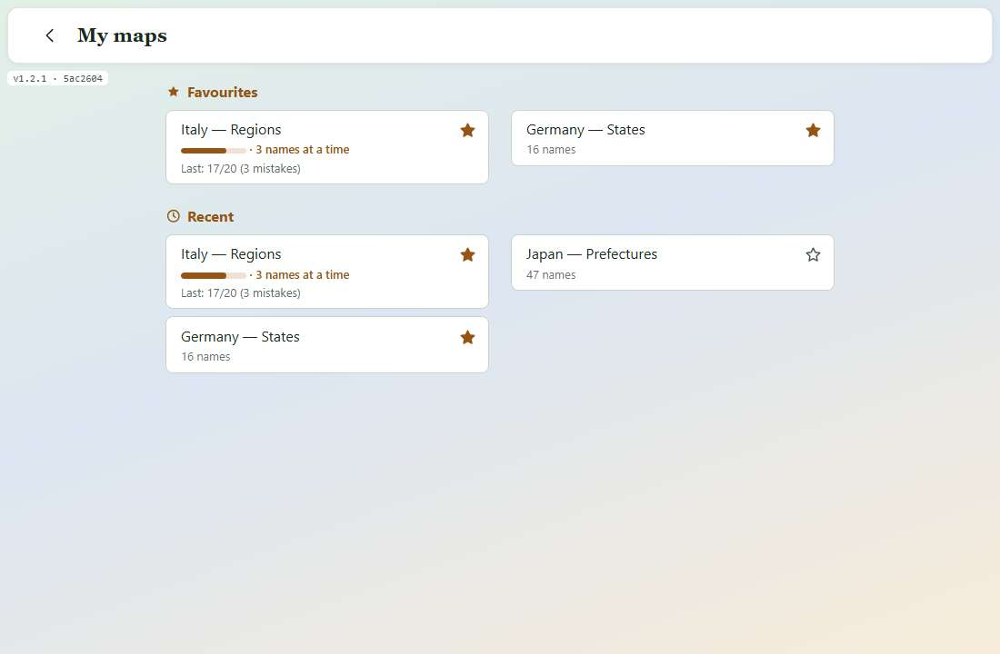

Der Stern fügt eine Karte den Favoriten hinzu; ein weiterer Druck nimmt sie wieder heraus. **Meine Karten** zeigt Favoriten und zuletzt verwendete Karten mit direktem Zugang. Ein gefüllter Stern kennzeichnet einen Favoriten. Das Entfernen aus den Favoriten löscht weder Ergebnisse noch Stufen. Eine Karte, deren Namen du alle weißt, zeigt „★ Gemeistert · Bestzeit 1:42“; eine nie gespielte Karte nennt die Zahl ihrer Namen, etwa „20 Namen“. Ist die Seite leer, öffne eine Karte oder wähle ihren Stern.

## 15. Das Tutorial

Das Tutorial verwendet Italien — Regionen als getrennte Übung, die den echten Lernstand nicht verändert. **Los geht's** startet die Einführung. Nach einer Unterbrechung setzt **Fortsetzen** den vorhandenen Ablauf fort; du kannst auch von vorn beginnen. Eine Karte erklärt die nächste Handlung und hebt die betreffende Stelle hervor.

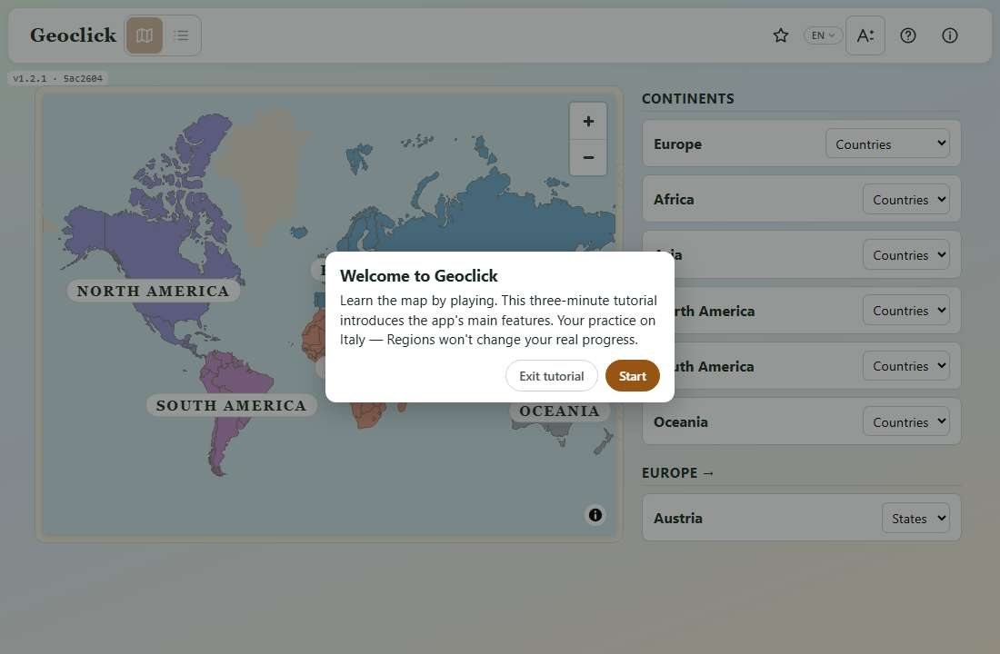

| Schritt | Handlung |
|---|---|
| 1 | Europa auf der Weltkarte auswählen |
| 2 | Italien auswählen |
| 3 | Regionen in der italienischen Zeile öffnen |
| 4 | Zoomen oder die Karte verschieben |
| 5 | In Gewusst den Namen einer Region hinzufügen |
| 6 | Gelände ein- oder ausschalten |
| 7 | Übersicht öffnen |
| 8 | Quiz öffnen |
| 9 | Einen Namen richtig platzieren, zum Beispiel Sicilia |
| 10 | Absichtlich falsch antworten und die Korrektur ansehen |
| 11 | In der Übersicht nachschlagen |
| 12 | Zum Quiz zurückkehren |
| 13 | Die Erklärung zu den Stufen lesen und weitergehen |
| 14 | Tour öffnen |

Erfolgreiche Handlungen führen zum nächsten Schritt. Eine reine Erklärung nutzt den Knopf zum Weitergehen. Zurück führt zum vorherigen Schritt. **Tutorial beenden** oder Esc beendet die Übung und stellt das normale Spiel wieder her, ohne Übungsergebnisse zu übernehmen. Die letzte Karte bietet **Fertig** zum Beenden und **Nochmal** zum Wiederholen. Wenn du während der Übung anderswohin wechselst, kannst du zum vorgesehenen Ablauf zurückkehren. Auf Touchscreens sprechen die Hinweise von Tippen und Gesten anstelle der Maus.

## 16. Sprachen

Das Sprachmenü bietet English, Deutsch und Italiano. Die Wahl betrifft Oberfläche, Meldungen, verfügbare übersetzte Länder- und Ortsnamen, geschriebene Ortsinformationen und dieses Handbuch. Sie wird auf dem Gerät gespeichert und verändert keine Lernergebnisse. Manche Ortsnamen bleiben in der örtlichen Form. Die gemeinsamen Handbuchbilder zeigen weiterhin die englische Oberfläche, wie oben erläutert.

## 17. Auf dem Telefon

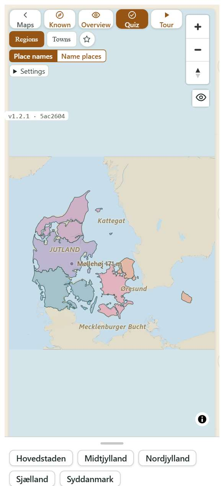

Tippen wählt Länder und Orte aus. Mit einem Finger verschiebst du die Karte, mit zwei Fingern zoomst du. Beginne einen Quiz-Zug direkt auf einem Namen in der Ablage; Ziehen auf der freien Karte bewegt stattdessen die Karte. Beim Ziehen schwebt der Name über dem Finger, und die orange umrandete Nadel darunter markiert den Punkt, der zählt. Du kannst einen Namen auch antippen und dann seinen Ort antippen. Die Höhe der Ablage lässt sich anpassen. Zoome kleine Ziele bei Bedarf heran. Ein Tipp auf einen Namen in der Übersicht vergrößert ihn; ein weiterer Tipp oder ein Tipp daneben verkleinert ihn.

Androids Zurück-Taste führt innerhalb einer Karte zur Startseite. Auf der Startseite steigt sie zunächst aus einer tieferen geografischen Ansicht zur Welt auf; wenn nichts mehr geschlossen werden muss, kann sie die App verlassen. Native Apps haben zusätzlich einen Beenden-Knopf. In der Android-App gibt das Telefon bei einer richtigen Antwort einen leichten Tipp, bei einer falschen ein doppeltes Brummen, außer wenn es auf reduzierte Bewegung eingestellt ist. Ein Wechsel der Geräteausrichtung erfordert keinen Neustart der Quizrunde.

## 18. Windows und Android

Die Apps besitzen dieselben Spielansichten, Sprachen, Favoriten und das Tutorial wie die Browserfassung. Die Android-App vibriert zusätzlich bei Quizantworten; Töne gibt es überall erst nach einem Druck auf **Ton**. Karten und weitere Ressourcen liegen im Installationspaket und stehen ohne Verbindung bereit. Der App-Lernstand ist vom Browser getrennt, auch auf demselben Gerät. Installiere ein Update über die vorhandene App, um ihre Daten zu behalten. Eine Deinstallation einschließlich der Daten kann diese entfernen.

Unter Windows startet das Fenster normalerweise mit 1280 × 800 und kann verkleinert oder vergrößert werden. Auf dem Telefon passen sich Leisten und Ablage dem Platz an. Versionsfeld und Informationsseite nennen die installierte Build.

## 19. Daten und Privatsphäre

Es gibt kein Benutzerkonto und keine Synchronisierung des Lernstands zwischen Geräten. Lokal gespeichert werden die Stufen jedes Ortes, Kartenergebnisse und Bestzeiten, Verwechslungen, Favoriten, zuletzt verwendete Karten, Sprach-, Gelände- und Toneinstellung, die gewählte Quizart sowie der Zustand des Tutorial-Angebots. Unterschiedliche Browser und native Apps haben getrennte Speicher.

Das Löschen der Webseitendaten löscht den Lernstand dieses Browsers. Eine Deinstallation samt App-Daten entfernt ihn aus der App. Normales Spielen und falsche Antworten löschen nicht das gesamte Archiv. Die Browserfassung lädt benötigte Spieldateien von der Webseite; externe Links benötigen die entsprechende Netzwerkverbindung. Quellen und Lizenzen stehen in den Karteninformationen.

## 20. Der Kartenkatalog

Die 221 Karten umfassen Länder und Hauptstädte der sechs Kontinente, nationale Verwaltungsgebiete, Städte und detaillierte Unterteilungen. Suche auf der Startseite nach einem Land; für feinere Unterteilungen aktiviere Detaillierte Karten anzeigen. Singapur verwendet Regionen und 55 Planungsgebiete. Sehr weit entfernte Überseegebiete werden weggelassen, wenn sie das Hauptgebiet zu stark verkleinern würden.

Zu den Quellen gehören Natural Earth, Wikidata und offen nutzbare Verwaltungsregister oder Grenzdaten mit den jeweils angegebenen Lizenzen. Eine Städteauswahl ist keine vollständige Liste sämtlicher Siedlungen. Grenzen und statistische Angaben ändern sich; die verwendeten Quellen werden beim Kartenbau festgehalten.

## 21. Häufige Fragen

**Warum sehe ich einen Namen nicht?** Zoome hinein: Beschriftungen ohne genügend Platz werden ausgeblendet. In Gewusst bleiben ungelernte Namen verborgen, bis du sie selbst auswählst.

**Warum sinkt die Zahl gewusster Orte?** Eine falsche Antwort senkt den betroffenen Ort um eine Stufe, von Gewusst auf Fast. Eine richtige Antwort in einer späteren Runde macht ihn wieder gewusst.

**Wie fange ich eine Karte neu an?** In Gewusst über **Fortschritt zurücksetzen** in der Legende, bestätigt mit **Ja, zurücksetzen**. Das betrifft nur diese Karte.

**Warum bietet das Quiz nur einen Namen an?** Du kennst mindestens 85% der Karte. Das Quiz zeigt dann weniger Hinweise gleichzeitig.

**Ich habe losgelassen, aber nichts ist passiert.** Der Name landete im Meer, außerhalb der Ziele oder wieder in der Ablage. Du kannst ohne Strafpunkt erneut ziehen.

**Wo finde ich eine Detailkarte?** Öffne eine Karte des Landes und aktiviere Detaillierte Karten anzeigen. Das rote X entfernt nur den zusätzlichen Zugang einer bereits geöffneten Karte.

**Kann ich auf mehreren Geräten spielen?** Ja. Jedes hat seinen eigenen Lernstand; ein automatischer Abgleich findet nicht statt.

**Welche Version habe ich?** Lies das Versionsfeld oder die Informationsseite. [Quellcode und veröffentlichte Versionen](https://github.com/diegoami/Geoclick2027) gehören zum offiziellen Repository.

## 22. Begriffe

| Begriff | Bedeutung |
|---|---|
| Ort oder Ziel | Region, Stadt, Hauptstadt oder Land, das du erkennen sollst |
| Karte | Eine Auswahl mit eigenem Lernstand |
| Stufe | Wie gut du einen Ort weißt: keine, Einmal, Fast, Gewusst; eine Stufe hoch je richtiger erster Antwort, eine herunter je Fehler |
| Gewusst | Die oberste Stufe, drei Stufen über keiner |
| Übungsrunde | Eine Runde nur mit den noch nicht gewussten Namen |
| Gemeistert | Eine Karte, deren Namen du alle weißt; ihre Runden werden gestoppt |
| Ablage | Unterer Bereich mit den zu ziehenden Namen |
| Gewählt | Vorübergehend selbst eingeblendeter Name in Gewusst |
| Übersicht | Lernansicht ohne Bewertung |
| Gelände | Zusätzliche geografische Darstellung hinter den Lerngebieten |
| Detailkarte | Eine feinere Unterteilung oder dichtere Auswahl hinter dem entsprechenden Häkchen |
